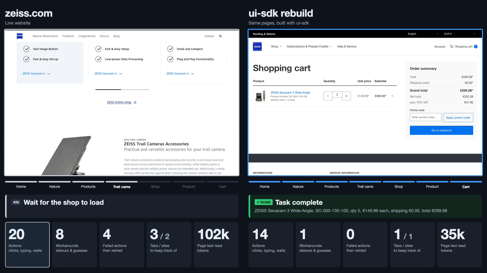

# ZEISS homepage on ui-sdk

A minimal rebuild of the [ZEISS Group homepage](https://www.zeiss.com/corporate/en/home.html) and one buyer journey with [ui-sdk](https://github.com/vercel-labs/ui) (`@ui-sdk/react`), styled with ZEISS brand tokens. It exists to show what the site could look like on ui-sdk, and how that changes the way AI agents navigate it.

The buyer journey follows the live site from the homepage to a cart: Nature Observation, its products, the trail-camera comparison, and the ZEISS Hunting & Nature shop's listing, product page, cart drawer, and cart page.

> [!NOTE]
> **About ZEISS content.** This is an independent, non-commercial research project. It is not affiliated with, endorsed by, or sponsored by Carl Zeiss AG or its licensees.
>
> - It recreates only a small fraction of the publicly available ZEISS website: the homepage and one buyer journey. The aim is to benchmark how easily AI agents can navigate a website, not to copy or replace the site.
>
> - ZEISS, the ZEISS logo, product names, texts, and images belong to Carl Zeiss AG and their respective owners. The rebuild loads images from zeiss.com at runtime and does not redistribute them. The screenshots and video in `docs/` show the sites only to document the comparison.
>
> - We believe this limited use for research, benchmarking, and commentary constitutes fair use. If you represent ZEISS and would like anything changed or removed, please open an issue, and we will act on it promptly.

## Agent navigability comparison

[Watch the side-by-side video](docs/video/agent-journey-side-by-side.mp4) (~2 minutes, 1920×1080).

Two agents completed the trail-camera buyer journey side by side—zeiss.com on the left and the ui-sdk rebuild on the right:

| Metric | zeiss.com | Rebuild |
| --- | --- | --- |
| Correct cart (€299.98) | ✅ | ✅ |
| Actions (clicks, typing, keys, and waits) | 36 | 14 |
| Workarounds (flagged by the agent) | 14 | 1 |
| Failed actions | 7 | 0 |
| Tabs / sites | 3 / 2 | 1 / 1 |
| Page text read | ~154k tokens | ~35k tokens |

Both agents were given the exact same instructions and task. You can view the [prompt used for the video](.agents/skills/agent-navigability-comparison/references/video-agent-prompt.md) and read the full comparison in the [agent navigability report](docs/agent-navigability.md).
