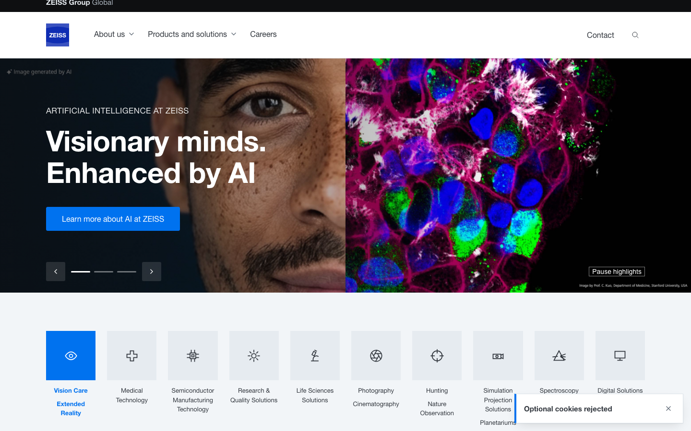

# ZEISS homepage on ui-sdk

A minimal rebuild of the [ZEISS Group homepage](https://www.zeiss.com/corporate/en/home.html) and one buyer journey with [ui-sdk](https://github.com/vercel-labs/ui) (`@ui-sdk/react`), styled with ZEISS brand tokens. It exists to show what the site could look like on ui-sdk, and how that changes the way AI agents navigate it.

The buyer journey follows the live site from the homepage to a cart: Nature Observation, its products, the trail-camera comparison, and the ZEISS Hunting & Nature shop's listing, product page, cart drawer, and cart page.

> [!NOTE]
> **About ZEISS content.** This is an independent, non-commercial research project. It is not affiliated with, endorsed by, or sponsored by Carl Zeiss AG or its licensees.
>
> - It recreates only a small fraction of the publicly available ZEISS website: the homepage and one buyer journey. The aim is to benchmark how easily AI agents can navigate a website, not to copy or replace the site.
>
> - ZEISS, the ZEISS logo, product names, texts, and images belong to Carl Zeiss AG and their respective owners. The rebuild loads images from zeiss.com at runtime and does not redistribute them. The screenshots and video in `docs/` show the sites only to document the comparison.
>
> - We believe this limited use for research, benchmarking, and commentary constitutes fair use. If you represent ZEISS and would like anything changed or removed, please open an issue, and we will act on it promptly.



## What it shows

Each section uses a different ui-sdk behaviour:

| Section | Component |
| --- | --- |
| Cookie banner | Dialog, Collapsible, Switch |
| Header | Navigation Menu, Command search in a Dialog (⌘K) |
| Hero | Carousel with autoplay, indicators, and a play toggle |
| Divisions | Tabs |
| Focus topics | Toggle Group filter |
| Newsroom | Pagination |
| Events | Accordion, Hover Card |
| Contact | Drawer with Field, Input, Select, Textarea, Checkbox, and Toast |
| Footer | Select, Tooltip |
| Trail-camera comparison | Carousel |
| Shop listing | Popover filter with Checkbox Group and range Slider, Select sort |
| Product page | Carousel gallery, Number Input quantity, Accordion |
| Cart | Drawer, Number Input, Input promo code |

The page registers ui-sdk's `snapshot`, `act`, and `query` tools through WebMCP, so a browser agent can operate it directly.

Photography is loaded at runtime from zeiss.com; no ZEISS assets are stored in this repository.

## Agent navigability

[docs/agent-navigability.md](docs/agent-navigability.md) compares how well an AI agent can navigate this rebuild and the live zeiss.com, on the buyer journey and on eight homepage tasks. It includes a [side-by-side video](docs/video/agent-journey-side-by-side.mp4) of two agents doing the buyer journey.

## Development

Requires [Vite+](https://viteplus.dev) and pnpm.

```sh
pnpm install
pnpm dev
pnpm build
```
