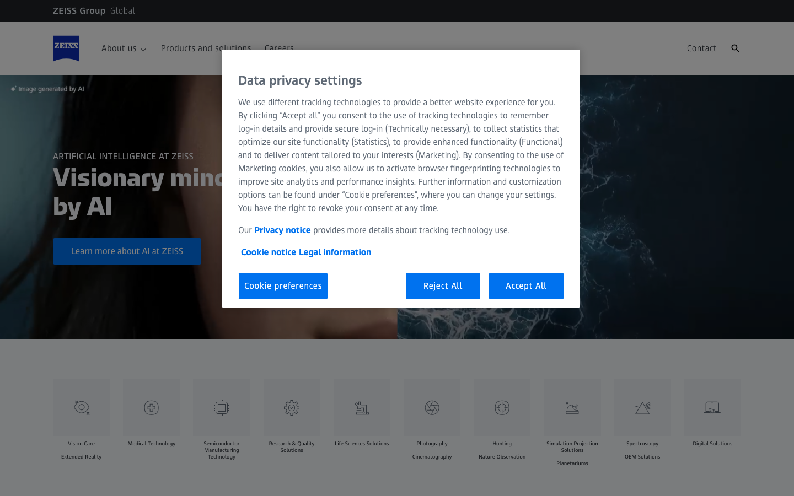
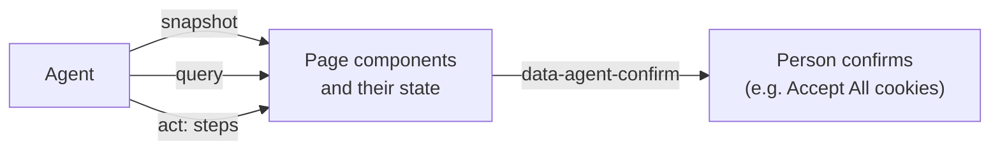

# Agent navigability: zeiss.com vs. the ui-sdk rebuild

This document compares how easily an AI agent can navigate and operate two versions of the ZEISS Group homepage:

- **Original:** the live <https://www.zeiss.com/corporate/en/home.html>.
- **Rebuild:** this project, a minimal clone built with [ui-sdk](https://github.com/vercel-labs/ui) (`@ui-sdk/react`), served locally at `http://localhost:5199/`.

| Original | Rebuild |
| --- | --- |
|  |  |

> [!NOTE]
> Each site was tested by a separate agent that knew nothing about how either site was built. Both agents got the same eight tasks, used the same tools, and saw only one site each.

## Verdict

| | Original | Rebuild |
| --- | --- | --- |
| Overall score | **5 / 10** | **8 / 10** |
| Tasks fully done (UI) | 4 of 8 | 8 of 8 |
| Tasks done without leaving the homepage | 4 of 8 | 8 of 8 |
| Total UI actions | 20 | 17 |
| DOM or CSS workarounds needed | 3 tasks | 0 |
| WebMCP tools exposed | None | `snapshot`, `act`, `query` |

The rebuild is easier for agents to navigate. Its controls carry the right roles, names, and states, so an agent works the page with role- and label-based selectors and doesn't need to read raw CSS or HTML. The clearest difference is in forms and custom widgets: the original's contact form and footer site switcher can't be operated through the accessibility tree at all, while the rebuild's are standard labelled controls.

The original isn't bad everywhere. Its tabs, search combobox, cookie dialog, and event list are well built, and on reading content it is about as good as the rebuild.

> [!IMPORTANT]
> The rebuild is a single page with much less content and no real backend. Search only jumps to sections of the page, and the contact form submits nowhere. Some of its advantage comes from that smaller surface: fewer links, no separate results or contact pages, and no third-party form embeds.

## Method

- **Tooling:** Playwright 1.65, Chromium, 1440×900 viewport.
- **Perception:** the agents worked only from what a generic browsing agent can see: the accessibility tree (`ariaSnapshot`), roles and accessible names (`getByRole`, `getByLabel`), visible text, and the DOM as a fallback.
- **WebMCP:** before each page load, a script stubbed `document.modelContext.registerTool`, the browser API sites use to hand tools to an agent, and recorded any registrations. Where tools appeared, the agent repeated the tasks through them on a fresh page load.
- **Tasks:**
  1. Reject optional cookies.
  2. Find the divisions through the main navigation, then the Photography offering.
  3. Search for "Planetariums".
  4. Read the latest news headline, then get to older news.
  5. Find the date and place of the second upcoming event.
  6. Fill the contact form without submitting it.
  7. Switch the footer website selector to a German site.
  8. Filter the stories by "Sustainability".

## Task-by-task results (UI)

| # | Task | Original | Rebuild |
| --- | --- | --- | --- |
| 1 | Reject cookies | ✅ 1 action | ✅ 1 action |
| 2 | Divisions → Photography | 🟡 3 actions. The main navigation has no division list, and "Products and solutions" is a plain link to another page | ✅ 2 actions. The menu panel lists all 15 divisions and selects the matching tab |
| 3 | Search "Planetariums" | ✅ 3 actions, on a separate results page with unnamed pagination | ✅ 3 actions. The search box jumps to the Planetariums tab |
| 4 | Latest news → older | 🟡 2 actions. Had to leave for the press page, where "next page" is an unnamed button | ✅ 1 action, `button "Next news page"` |
| 5 | Second upcoming event | ✅ 0 actions, readable straight from the tree | ✅ 1 action, opening the accordion item |
| 6 | Contact form | 🟡 8 actions. Inputs are hidden from the tree (`aria-hidden` wrappers, labels not linked to inputs); filled by CSS selector | ✅ 6 actions. Labelled fields in `dialog "Contact ZEISS"` |
| 7 | Footer → German site | 🟡 2 actions. The trigger is a plain `div`, not a control; clicked by its visible text | ✅ 2 actions, `combobox "Select website"` → `option "Deutschland (Deutsch)"` |
| 8 | Filter by Sustainability | ✅ 1 action, with caveats: no pressed state, a 5–10 s animation, and every card named "Access Tile" | ✅ 1 action. `button "Sustainability" [pressed]`, and the live text "2 stories shown" updates |

✅ done cleanly · 🟡 partial, or needed a workaround

## What differs

### Accessibility tree

| | Original | Rebuild |
| --- | --- | --- |
| Snapshot size | about 12.8k characters, 295 lines, about 88 controls (68 links) | about 8.8k characters, 254 lines |
| Signal vs. noise | about 70% meaningful. Noise includes about 30 country links, `paragraph` wrappers inside buttons, and stray hint text | almost all meaningful. Noise is 3 empty nodes and a few loose text nodes |
| Page behind the modal | Not inert: the whole page stays in the tree, and the dialog comes last, after the footer | Inert: everything behind the dialog is reported as disabled |
| Landmarks | banner, two navigations both named "Main navigation", main, contentinfo | banner, `navigation "Main"`, main, named regions per section, contentinfo |

### Control states

| State | Original | Rebuild |
| --- | --- | --- |
| `selected` on tabs | ✅ | ✅ |
| `expanded` on menus and accordions | Only "About us"; footer accordions have none | ✅ menus, search, accordion, selects |
| `pressed` on filter chips | ❌ | ✅ |
| `aria-current` on pagination | ❌ | ✅ (in the DOM; Playwright's snapshot doesn't display it) |
| Filter results announced | ❌ | ✅ via a polite live region |

### Names

- **Original:** 7 story cards all named `link "Access Tile"`; unnamed pagination and video buttons; names that differ from the visible text (`link "ZEISS history"` shows "History"; `link "Sustainbility at ZEISS"` is misspelled); a double-escaped `link "ZEISS Facts &amp;amp; Figures"`.

- **Rebuild:** icon buttons are named (`button "Search on site"`, `button "Next news page"`, `button "Pause highlights"`). Some duplicates remain: `link "Service & contact"` ×2 and `link "Contact"` ×2 in the division panels, and the page buttons are named only "1", "2", and "3".

### Custom widgets

- **Original:** the contact form is effectively invisible to role- and label-based agents. The footer website and ZEISS area selectors are plain `div` triggers that keyboard and agent can't reach as controls.

- **Rebuild:** every interactive widget is a ui-sdk component with the standard ARIA pattern. The one friction point is that its selects are custom comboboxes, so Playwright's `selectOption` doesn't work and the agent has to open the list and click the option.

## WebMCP tools (rebuild only)

The original registers no tools. The rebuild registers three:

| # | Task | Tool pass | Notes |
| --- | --- | --- | --- |
| 1 | Reject cookies | ✅ 1 call | Result reports that the dialog is gone |
| 2 | Divisions → Photography | 🟡 2 calls | Can open the menu and switch tabs, but menu links and card links aren't components, so `query` finds nothing |
| 3 | Search | 🟡 2 calls | `setQuery` stored an internal value instead of filtering; `run "Planetariums"` worked |
| 4 | News | 🟡 1 call | Pagination works; headlines need the DOM |
| 5 | Events | 🟡 2 calls | `open` rejected the label "Carrefour Pathologie 2026" and accepted only the value `carrefour`; date and place need the DOM |
| 6 | Contact form | ✅ 1 call | One `act` opened the drawer and filled every field, reporting `required` |
| 7 | Footer site | ✅ 1 call | |
| 8 | Filter | 🟡 1 call | Toggle works; story titles aren't components |

Through the tools, anything that **changes** the page is faster: the whole contact form takes one call instead of six actions, and errors list the valid options. But the tools can't **read** content (headlines, event details, card links, story titles), so 5 of 8 tasks still need a DOM read. As built, the tools work alongside the accessibility tree; they can't stand in for it.

## Improvements the rebuild could make

These come from the rebuild agent's findings and are fixable in this project:

- **Unique names:** give repeated card links a unique name, such as "Service & contact for Photography".

- **Distinct menu targets:** link each mega-menu item to its own anchor instead of `#divisions`, and name the menu's list.

- **Page button names:** name the pagination buttons "News page 2" and so on, rather than bare numbers.

- **Search feedback:** report a result count in the search status region, and move focus to the selected section after a search.

- **One name for the drawer:** keep the contact drawer's name the same open and closed. It is "Find the right contact person" closed and "Contact ZEISS" open.

- **Content for tool-only agents:** to let a tools-only agent read content, expose key content as components (for example, news and story lists built on Listbox or Tree), or rely on `snapshot` returning section text.

## Reproducing

- Both agents' scripts are in `/tmp/zeiss-check/eval-original/` and `/tmp/zeiss-check/eval-clone/`.
- Start the rebuild with `pnpm dev --port 5199`, then rerun the scripts with `node`.
