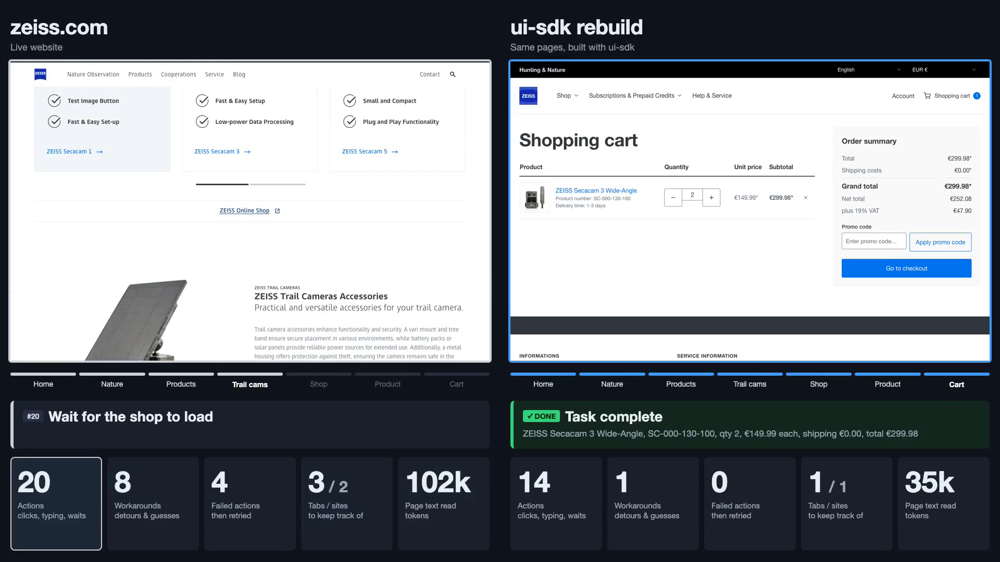
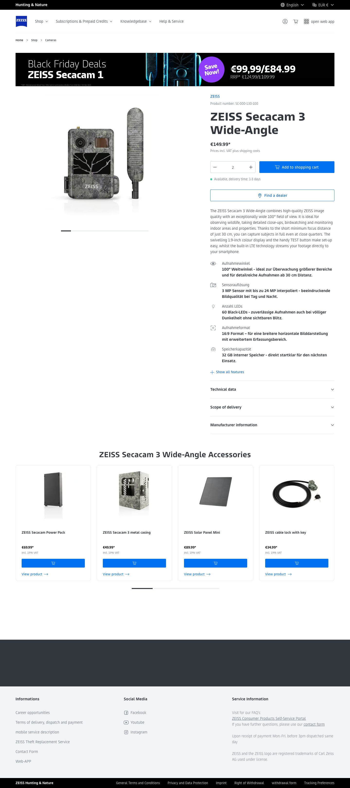
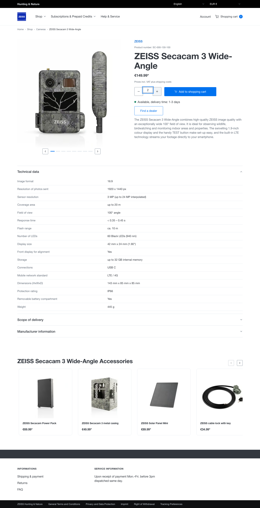
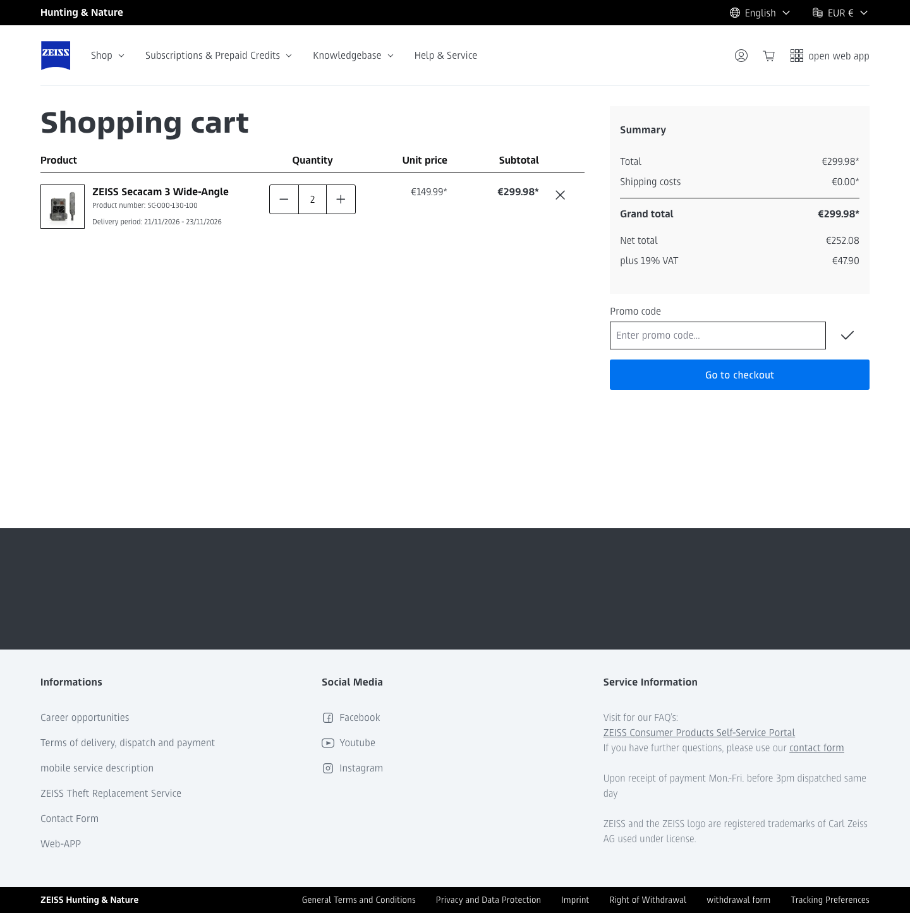
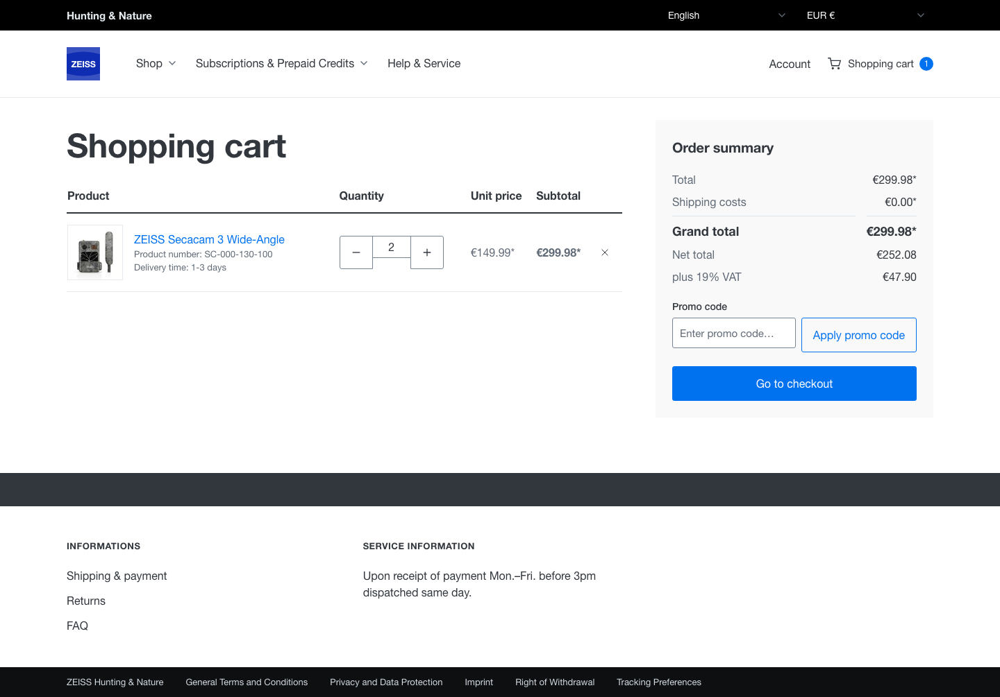
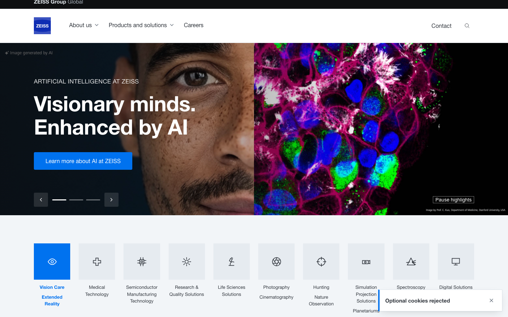

# Agent navigability: zeiss.com vs. the ui-sdk rebuild

This document compares how easily an AI agent can navigate and operate two versions of the ZEISS website:

- **Original:** the live site (zeiss.com), starting at <https://www.zeiss.com/corporate/en/home.html>. The buyer journey continues to the ZEISS Hunting & Nature shop at `shop.zeiss.com`.
- **Rebuild:** this project, built with [ui-sdk](https://github.com/vercel-labs/ui) (`@ui-sdk/react`) and served locally at `http://localhost:5199/`.

The comparison has two parts, and the rebuild recreates the pages that both of them need:

- a **buyer journey**, in which a customer goes from the ZEISS Group homepage to a cart with two trail cameras in it;
- **eight homepage tasks**, such as rejecting cookies, searching, and paging the news.

## How the comparison was run

The comparison was run twice, each time with fresh agents:

1. **The written evaluation** covers both parts. Two agents, one per site, drove a browser with Playwright scripts (Chromium at 1440×900) and wrote a report on each task. The [Verdict](#verdict), [Buyer journey](#buyer-journey), and [Homepage tasks](#homepage-tasks) sections come from this run.
2. **The recorded run** covers only the buyer journey. Two more agents, one per site, used a recorded browser that logged every action. The [video](#video-the-buyer-journey-side-by-side) and its counts come from this run.

In both runs, each agent saw only one site and knew nothing about how either site was built. Both agents in a run got identical instructions and tasks. The prompts, tasks, and scripts are in the `agent-navigability-comparison` skill in `.agents/skills/`.

### Terms used in this report

- **Accessibility tree:** the browser's structured view of a page: each control's role (`button`, `link`, `checkbox`), its accessible name, and its state (expanded, checked, pressed). A browsing agent mostly "sees" a page through this tree, so a control is quoted here as role and name, for example `button "Reject All"`.
- **Snapshot:** a text dump of the accessibility tree that the agent reads. Its size is a rough measure of how much the agent has to read on each page.
- **Action:** one thing the agent does to the page, such as a click, a fill, a key press, or a tool call.
- **Workaround:** an action that isn't the obvious next step, such as retrying, choosing a button by its position because several share a name, typing a URL, or using CSS selectors or screen coordinates instead of the accessibility tree.
- **WebMCP:** a proposed browser API that lets a page register tools an agent can call directly. The rebuild registers three ui-sdk tools: `snapshot` (describe the page), `act` (operate controls), and `query` (find components). The original registers none.
- **Score:** each agent's own rating out of 10 for how easy its site was to navigate. It's a judgement, not a computed metric.

## Verdict

|                                         | Original          | Rebuild                    |
| --------------------------------------- | ----------------- | -------------------------- |
| **Buyer journey score**                 | **6.5 / 10**      | **8 / 10**                 |
| Journey completed with the correct cart | ✅                | ✅                         |
| Journey actions                         | 18                | 14                         |
| Journey workarounds                     | 7                 | 1                          |
| Tabs and domains                        | 3 tabs, 2 domains | 1 tab, 1 domain            |
| **Homepage tasks score**                | **5 / 10**        | **8 / 10**                 |
| Homepage tasks fully done               | 4 of 8            | 8 of 8                     |
| WebMCP tools exposed                    | None              | `snapshot`, `act`, `query` |

These numbers come from the written evaluation. The recorded run in the [video](#video-the-buyer-journey-side-by-side) counted more actions on the original (36 rather than 18), for reasons given in that section.

Both agents bought the right camera. The difference is in how much an agent has to work around the page. On the original, the agent had to:

- switch tabs twice, onto a second domain;
- reject cookies on two different banners;
- cope with a menu link that behaves differently depending on how fast it's clicked;
- close a filter panel that ignores Escape;
- pick buttons by position because 14 share the same name.

On the rebuild, every control on the path was found by role and accessible name. The one workaround was reading the cart totals.

The original is not bad everywhere. Its shop filter, quantity field, and add-to-cart announcements are well built, and on several steps it exposes as much state as the rebuild.

### What is and isn't due to ui-sdk

> [!IMPORTANT]
> The rebuild is a mock with less content and no backend: the shop has six cameras, the cart lives in the browser, and checkout isn't implemented. It also puts the whole journey on one domain, while the original crosses to a shop run by the ZEISS licensee Valyra. A real site has more content and more parties involved, so it would not be as lean as this mock even if it were built on ui-sdk.

**Likely due to ui-sdk's components.** These are properties of the controls themselves, so they don't depend on the site being small:

- names that are unique and include their context, so the agent never had to pick a control by its position;
- state the agent can read (expanded, pressed, checked, result counts) without taking a screenshot;
- form fields and selects that are labelled and can be operated from the accessibility tree;
- controls that behaved consistently in these runs, where the original had a link, a filter toggle, and a panel that did not (see Predictability under [What differs, in general](#what-differs-in-general)).

**Mostly due to the rebuild being a small, single-site mock:**

- smaller snapshots and less page text read, since there is less content;
- one tab and one domain instead of three tabs and two domains, and with that some of the original's workarounds;
- fewer steps on some pages, since the mock has fewer links and products.

**Further limits:**

- Each figure comes from one agent per site per run. A repeat run takes a slightly different route and gets different counts, as the gap between the two runs' counts on the original shows.
- Scores are the agents' own ratings, not measurements.
- The rebuild was built knowing which tasks would be tested, and with names chosen to match visible text. The original was not built with this test in mind.

## Video: the buyer journey side by side

[Watch the clip](video/agent-journey-side-by-side.mp4) (about 2 minutes, 1920×1080). This is the recorded run: two fresh agents, separate from those in the written evaluation, did the buyer journey, one per site. A red box marks each control just before the agent uses it. Thinking pauses are cut, so the length of each side tracks how many actions it took. "Page text read" estimates the snapshot text the agent read, as characters ÷ 4.

| Recorded run                              | zeiss.com    | Rebuild     |
| ----------------------------------------- | ------------ | ----------- |
| Correct cart (€299.98)                    | ✅           | ✅          |
| Actions (clicks, typing, keys, and waits) | 36           | 14          |
| Workarounds (flagged by the agent)        | 14           | 1           |
| Failed actions                            | 7            | 0           |
| Tabs / sites                              | 3 / 2        | 1 / 1       |
| Page text read                            | ~154k tokens | ~35k tokens |
| Agent's own score                         | 5 / 10       | 8 / 10      |

- **Where the zeiss.com run lost time:**
  - The **Products** mega-menu on the Nature Observation site: four clicks on "Trail Cameras" either timed out or did nothing, so the agent finally typed the page's URL.
  - The shop's **filter panel** stayed open over the first product card. Clicks on it failed until the agent scrolled up and closed the panel with its toggle, because Escape didn't close it.
  - The **cart panel** never appeared in the accessibility tree, so the agent needed a screenshot to find "Display shopping cart".
- **The rebuild run's one workaround** was the shop's second cookie banner, which the rebuild copies from the original.

### Every action in the recorded run

The table lists every action each agent took, grouped by stage of the journey, so you can see where the two runs part ways. Each action is shown with the agent's own caption for it, as overlaid on the video. Reading the page (snapshots) and screenshots aren't actions, so they're left out.

❌ failed · ⚠️ workaround (flagged by the agent) · ⏳ wait

| Stage | zeiss.com | Rebuild |
| --- | --- | --- |
| Homepage → Nature Observation | **5 actions** (1 failed, 1 workaround) 1. ❌ Open the Hunting / Nature Observation tab 2. Accept the cookie banner 3. Open the Hunting & Nature Observation segment 4. Go to ZEISS products for nature observation (opens a new tab) 5. ⚠️ Switch to the newly opened Nature Observation tab | **3 actions** 1. Accept cookies 2. Open Hunting and Nature Observation division 3. Open nature observation products |
| Nature Observation → Trail Cameras | **13 actions** (3 failed, 7 workarounds, 3 waits) 6. Open the Products page 7. Open Trail Cameras from the Products menu 8. ⏳ Let the trail cameras page load 9. ⚠️ Reopen the Products menu 10. ❌⚠️ Open Trail Cameras from the menu 11. ⏳ Wait for Trail Cameras page to load 12. ⚠️ Hover Products to open its menu 13. ❌⚠️ Open Trail Cameras from the menu 14. ⚠️ Open the Products menu 15. ⚠️ Expand Trail Cameras in the Products menu 16. ❌ Open the Trail Cameras overview page 17. ⏳ Wait for the trail cameras page 18. ⚠️ Open Trail Cameras page via its menu link URL | **2 actions** 4. Open the Products menu 5. Open ZEISS Trail Cameras |
| Trail Cameras → shop | **3 actions** (1 workaround, 1 wait) 19. Go to the ZEISS Online Shop for trail cameras (opens a second new tab) 20. ⏳ Wait for the shop to load 21. ⚠️ Switch to the ZEISS Online Shop tab | **2 actions** (1 workaround) 6. Go to the ZEISS Online Shop 7. ⚠️ Dismiss the shop cookie banner |
| Filter and pick the camera | **10 actions** (3 failed, 5 workarounds, 1 wait) 22. Open the product filter 23. Filter to 100° wide-angle field of view 24. ⏳ Wait for filtered results 25. ❌ Open the Secacam 3 Wide-Angle product page 26. ❌⚠️ Close the filter panel covering the products 27. ❌⚠️ Open the Secacam 3 Wide-Angle product page 28. ⚠️ Close the filter dropdown covering products 29. ⚠️ Scroll up so the filter toggle is clear of the header 30. ⚠️ Collapse the filter dropdown 31. Open the Secacam 3 Wide-Angle product page | **4 actions** 8. Open the product filter 9. Filter to 100° wide-angle cameras 10. Apply filter and close the panel 11. Open the cheapest 100° camera |
| Quantity and add to cart | **3 actions** (1 wait) 32. Set quantity to 2 33. Add 2 cameras to the shopping cart 34. ⏳ Wait for the cart panel to open | **2 actions** 12. Increase quantity to 2 13. Add 2 cameras to the shopping cart |
| Cart page | **2 actions** (1 wait) 35. Open the full shopping cart page 36. ⏳ Wait for the cart page to load | **1 action** 14. Open the full shopping cart page |
| **Total** | **36 actions** (7 failed, 14 workarounds, 7 waits) | **14 actions** (1 workaround) |

Where the runs part ways:

- **Nature Observation → Trail Cameras** accounts for 11 of the 22 extra actions on zeiss.com (13 against 2). Its Products mega-menu took four attempts to open "Trail Cameras", until the agent typed the page's URL instead.
- **Filter and pick** accounts for 6 more (10 against 4). The open filter panel covered the product, so three clicks failed before the agent scrolled up and closed it.
- **The other 5** are spread out: a failed first click on the homepage, a switch to each of the two new tabs the live site opens, and waits for the cart panel and the cart page.
- Once on the product page, the two runs are nearly the same: set the quantity, add to cart, open the cart. zeiss.com needed only two extra waits there.

The repository doesn't keep the recorder's logs, so the captions and markers here were read from the video. They match the counts on its results card.

**Why these counts differ from the [Verdict](#verdict).** The original needed 36 actions here but 18 in the written evaluation, mainly because:

- These counts come from the recorder's log, not from the agents' own summaries.
- This zeiss.com agent struggled more with the mega-menu than the one in the written evaluation.
- The recorder counts waits as actions.

The zeiss.com run also had a setup problem on our side: it started without the browser's port number, so it had to find it. That cost time and possibly two or three repeat page reads (about 19k tokens), but no actions. It's also why the clip shows no clock.

The `agent-navigability-comparison` skill describes how to record and render the clip again.

## Buyer journey

This section and the next come from the written evaluation. The task, given verbatim to both agents:

> Starting from the ZEISS Group homepage, find ZEISS's trail cameras for nature observation and go to the official ZEISS online shop that sells them. In the shop, filter the trail cameras to those with a **100° wide-angle field of view**, and pick the **cheapest** one. Open its product page, set the quantity to **2**, and add it to the cart. Open the full shopping cart page, then report the product name, product number, quantity, unit price, shipping cost, and grand total. Do not click "Go to checkout" and do not enter any personal or payment data.

| Original product page                                                                         | Rebuild product page                                                                 |
| --------------------------------------------------------------------------------------------- | ------------------------------------------------------------------------------------ |
|  |  |

| Original cart                                                                                 | Rebuild cart                                                                         |
| --------------------------------------------------------------------------------------------- | ------------------------------------------------------------------------------------ |
|  |  |

### The path

```mermaid
flowchart LR
  A[ZEISS Group homepage] -->|"tab: Hunting / Nature Observation"| B[Nature Observation]
  B -->|Products| C[Products]
  C -->|ZEISS Trail Cameras| D[Trail Cameras]
  D -->|ZEISS Online Shop| E[Shop listing]
  E -->|"filter: 100° angle"| F[Product page]
  F -->|"quantity 2, add to cart"| G[Cart drawer]
  G -->|Display shopping cart| H[Cart page]
```

### Both agents ended with the same cart

| Field          | Original                           | Rebuild                            |
| -------------- | ---------------------------------- | ---------------------------------- |
| Product        | ZEISS Secacam 3 Wide-Angle         | ZEISS Secacam 3 Wide-Angle         |
| Product number | SC-000-130-100                     | SC-000-130-100                     |
| Quantity       | 2                                  | 2                                  |
| Unit price     | €149.99                            | €149.99                            |
| Shipping       | €0.00                              | €0.00                              |
| Grand total    | €299.98 (net €252.08 + VAT €47.90) | €299.98 (net €252.08 + VAT €47.90) |

### Step by step

| Step                               | Original                                                                                                                                                                                                                                                             | Rebuild                                                                                                                                               |
| ---------------------------------- | -------------------------------------------------------------------------------------------------------------------------------------------------------------------------------------------------------------------------------------------------------------------- | ----------------------------------------------------------------------------------------------------------------------------------------------------- |
| Homepage                           | 3 actions. Reject cookies, open the `tab "Hunting Nature Observation"`, and follow `link "ZEISS products for nature observation"`, which opens a **new tab** without saying so                                                                                       | 3 actions. Reject cookies, open the `tab "Hunting and Nature Observation"`, and follow `link "Products for nature observation"` in the same tab       |
| Nature Observation → Trail Cameras | 4 actions, including a tab switch. `link "Products"` navigates if clicked early but opens a mega-menu if clicked after scripts load. In the menu, `link "Trail Cameras"` opens a submenu with no `aria-expanded`, and "Overview" appears twice                       | 2 actions. `link "ZEISS Nature Observation Products"`, then `link "ZEISS Trail Cameras"` in its named region                                          |
| To the shop                        | 1 action, plus a tab switch. `link "ZEISS Online Shop"` opens a **second new tab** on `shop.zeiss.com`                                                                                                                                                               | 1 action. `link "ZEISS Online Shop"`, same tab                                                                                                        |
| Shop cookie banner                 | 1 action. A second, different banner: `dialog "Privacy Settings"` › `button "Deny"`                                                                                                                                                                                  | 1 action. The same banner design again: `button "Reject All"`                                                                                         |
| Filter                             | 4 actions. `button "Choose filter"` sometimes ignores the first click while the page loads. `checkbox "100° angle"` works, but nothing announces the new results, and the panel stays open over them. Escape doesn't close it, so the agent clicked the toggle again | 3 actions. `button "Choose filter" [expanded]`, `checkbox "100° angle" [checked]`, then `button "Show 2 products"`. A `status` announces "2 products" |
| Pick the product                   | 1 action, picked **by position**: every card has two links with the same name, and one card's image link is mislabelled "ZEISS Secacam 7"                                                                                                                            | 1 action. `link "ZEISS Secacam 3 Wide-Angle"`                                                                                                         |
| Quantity and add to cart           | 2 actions. `spinbutton "Quantity"` works, but `main` holds **14** `button "Add to shopping cart"`, so the agent picked the first by position                                                                                                                         | 2 actions. `textbox "Quantity"`, then `button "Add to shopping cart"`                                                                                 |
| Cart drawer → cart page            | 1 action. `dialog "Shopping cart"`, with an `alert` "2 products added to your shopping cart.", then `link "Display shopping cart"`                                                                                                                                   | 1 action. `dialog "Shopping cart"`, with a `status` "2 products added to your shopping cart.", then `link "Display shopping cart"`                    |
| Read the cart                      | Totals read **by position**: the `definition` values have no names                                                                                                                                                                                                   | Totals read through CSS (`dt`/`dd`): the summary has no queryable names either                                                                        |

### Shop controls and their state

| Control          | Original                                                            | Rebuild                                                                                           |
| ---------------- | ------------------------------------------------------------------- | ------------------------------------------------------------------------------------------------- |
| Filter toggle    | `aria-expanded`; renamed "1 filters active"                         | `aria-expanded`; renamed "1 filter active"; a labelled list "Active filters" with removable chips |
| Filter options   | Real checkboxes with `[checked]`, grouped as `list "Field of view"` | Real checkboxes with `[checked]` in labelled groups                                               |
| Result count     | None, and no live region                                            | `status` "2 products"                                                                             |
| Sort             | Unnamed `combobox`                                                  | `combobox "Sort by"`                                                                              |
| Price range      | Named spinbuttons; the two sliders have no names                    | Named thumbs "Minimum price" and "Maximum price"                                                  |
| Quantity         | `spinbutton` with value, min, and max; its live region stayed empty | `textbox` with a value; no min or max exposed. "Decrease quantity" shows `[disabled]` at 1        |
| Add to cart      | Opens `dialog "Shopping cart"` and announces through two `alert`s   | Opens `dialog "Shopping cart"`, moves focus into it, and announces through a `status`             |
| Header cart link | `link "Shopping cart"`, with no item count                          | `link "Shopping cart 1 item"` (it counts lines, not units)                                        |
| Page title       | Changes per page ("Shopping cart \| ZEISS Secacam")                 | "ZEISS Group Global" on every page                                                                |

### Accessibility snapshot size

| Page                   | Original                    | Rebuild                    |
| ---------------------- | --------------------------- | -------------------------- |
| Homepage               | 14.1k characters, 310 lines | 8.8k characters, 254 lines |
| Trail Cameras          | 15.6k characters, 335 lines | 4.1k characters, 120 lines |
| Shop listing, filtered | 6.9k characters, 211 lines  | 3.3k characters, 104 lines |
| Product page           | 15.7k characters, 342 lines | 6.5k characters, 185 lines |
| Cart page              | 5.2k characters, 145 lines  | 3.6k characters, 105 lines |

Both homepages are mostly noise for this task (about 95% of each is unrelated news, events, stories, and footer). The rebuild's pages are smaller mainly because they hold less content.

### Through the WebMCP tools (rebuild only)

No page on the original registers tools. On the rebuild, the agent repeated the journey through `snapshot`, `act`, and `query`. A **UI fallback** is a step where the tools couldn't do the job, so the agent operated the page directly instead:

| Step                               | Tool calls | UI fallbacks | Notes                                                                                                                                                                                                    |
| ---------------------------------- | ---------- | ------------ | -------------------------------------------------------------------------------------------------------------------------------------------------------------------------------------------------------- |
| Homepage                           | 2          | 0            | One `act` rejected cookies, opened the tab, and followed the link                                                                                                                                        |
| Nature Observation → Trail Cameras | 2          | 1            | Opening the menu works, but its links aren't components, so `query` returns nothing                                                                                                                      |
| To the shop                        | 1          | 0            |                                                                                                                                                                                                          |
| Filter and pick                    | 4          | 1            | An `act` that names "100° angle" fails while the filter popover is closed, and the error doesn't point to "Choose filter". The steps before the failure had already run. The product link needed a click |
| Quantity and add to cart           | 1          | 1            | One `act` set quantity 2 and added to the cart; "Display shopping cart" needed a click                                                                                                                   |
| Cart                               | 3          | 1            | `query` can't find "Grand total"; row text is cut at 80 characters, so prices are lost                                                                                                                   |

That's 13 tool calls (one failed) and 4 UI fallbacks. The agent rated the tools about 6/10 on their own. The tools are efficient for changing state, and they flag "Go to checkout" as needing a person. But they can't follow ordinary links or read prices and totals, so they work alongside the accessibility tree; they can't stand in for it.

## Homepage tasks

| Original                                                                            | Rebuild                                                                         |
| ----------------------------------------------------------------------------------- | ------------------------------------------------------------------------------- |
|  |  |

| #   | Task                     | Original                                                                                                    | Rebuild                                                                    |
| --- | ------------------------ | ----------------------------------------------------------------------------------------------------------- | -------------------------------------------------------------------------- |
| 1   | Reject cookies           | ✅ 1 action                                                                                                 | ✅ 1 action                                                                |
| 2   | Divisions → Photography  | 🟡 3 actions. The main navigation has no division list; "Products and solutions" leaves the page            | ✅ 2 actions. The menu lists all 15 divisions and selects the matching tab |
| 3   | Search "Planetariums"    | ✅ 3 actions, on a separate results page with unnamed pagination                                            | ✅ 3 actions. Search jumps to the Planetariums tab                         |
| 4   | Latest news → older      | 🟡 2 actions. Had to leave for the press page, where "next page" is unnamed                                 | ✅ 1 action, `button "Next news page"`                                     |
| 5   | Second upcoming event    | ✅ 0 actions, readable from the tree                                                                        | ✅ 1 action, opening the accordion item                                    |
| 6   | Contact form             | 🟡 8 actions. Inputs hidden from the tree (`aria-hidden` wrappers, unlinked labels); filled by CSS selector | ✅ 6 actions, labelled fields in `dialog "Contact ZEISS"`                  |
| 7   | Footer → German site     | 🟡 2 actions. The trigger is a plain `div`, clicked by its visible text                                     | ✅ 2 actions, `combobox "Select website"`                                  |
| 8   | Filter by Sustainability | ✅ 1 action, but no pressed state, a 5–10 s animation, and every card named "Access Tile"                   | ✅ 1 action, `button "Sustainability" [pressed]` with a live result count  |

✅ done cleanly · 🟡 partial, or needed a workaround

Through the tools, the rebuild agent changed state in fewer calls (the whole contact form in one `act`), but 5 of the 8 tasks still needed the page itself, because headlines, event details, and story titles aren't components.

## What differs, in general

- **Names:** the rebuild's controls carry names that include their context ("Quantity of ZEISS Secacam 3 Wide-Angle", "Remove ZEISS Secacam 3 Wide-Angle from shopping cart"). The original repeats generic names ("Add to shopping cart" ×14, "Access Tile" ×7, "View product" ×2 per card), so an agent falls back to position.
- **State:** both expose tab selection and checkbox state. The rebuild also exposes pressed toggles, filter results, the current page, and cart counts, which the original leaves out in places.
- **Predictability:** the rebuild's controls behaved consistently in these runs. On the original, a link changes behaviour after scripts load, a filter toggle ignores early clicks, and a panel ignores Escape.
- **Navigation:** the original opens new tabs without saying so and crosses domains, each with its own cookie banner. The rebuild stays in one tab. This comes from how the site is laid out, not from ui-sdk: the live site could also stay in one tab without changing its components.
- **Hidden controls:** the original's homepage contact form and footer site switcher can't be operated through the accessibility tree at all. Nothing on the rebuild needed CSS or coordinates to operate, only to read the cart totals.

## Improvements the rebuild could make

- **Page titles:** give each route its own `<title>`; every page is currently "ZEISS Group Global".
- **Quantity:** expose the quantity as a `spinbutton` with min and max, as the original does.
- **Cart summary:** name the summary values so "Grand total" can be queried, and count units as well as lines in the header cart link.
- **Dead ends:** point the homepage mega-menu links to real pages instead of `#divisions`, and give duplicate links unique names ("Service & contact" ×2).
- **Tools:** expose menu links and prices to the WebMCP tools, and make `act` open the filter popover when a step names a checkbox inside it.
- **Small fixes:** a stray space in card buttons ("Add to shopping cart : ZEISS Secacam 1"), and a second cookie banner on entering the shop that the rebuild copies from the original but doesn't need.

## Reproducing

- Install dependencies with `pnpm install`, then start the rebuild with `pnpm dev --port 5199`. It is then served at `http://localhost:5199/`.
- Follow the `agent-navigability-comparison` skill in `.agents/skills/`. It holds the evaluator prompt, the tasks, the WebMCP polyfill, the expected cart, and the scripts and prompt for recording the video.
- Expect some variation: the live site changes, and each run uses new agents that take slightly different routes.
